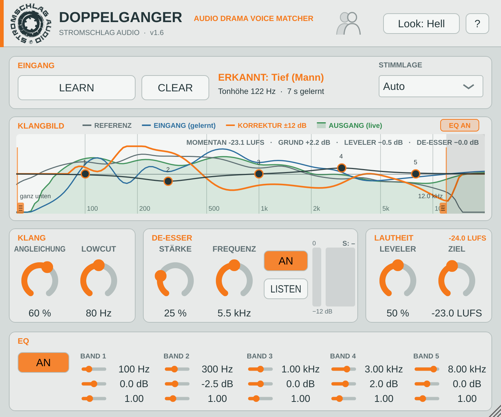

# DOPPELGANGER – Audio Drama Voice Matcher

<picture>
  <source media="(prefers-color-scheme: dark)" srcset="docs/logo-dunkel.png">
  
</picture>

VST3-Insert-Effekt für Hörspiel-Produktion. Er gleicht die Klangfarbe einer Sprecherspur an eine feste Referenzstimme
an und bringt sie gleich auf die richtige Lautheit: Mikrofon und Raum werden auf den Standard des Projekts gebracht,
ohne dass man jede Spur mit mehreren Plugins einzeln nachbearbeitet.

**⬇ Download (Windows · VST3 · Mono/Stereo):** https://github.com/StromschlagProductions/Doppelganger-vst/releases/latest

Installation: ZIP entpacken und den Ordner `Doppelganger.vst3` nach `C:\Program Files\Common Files\VST3` kopieren.

**Status:** Version 1.0. Klangfunktion und Oberfläche sind fertig, Feinabstimmung nach Praxistests.

## Warum es dieses Plugin gibt

Bisher lag auf jeder Sprecherspur eine Kette aus Match-EQ, Leveler/Kompressor und De-Esser, jede Spur einzeln
angeglichen an eine männliche oder weibliche Vorlage. DOPPELGANGER kennt diese Vorlagen fest und erledigt alles in
einem Plugin: auf die Spur ziehen, einmal lernen lassen, fertig.

– Lars Eickstädt, Stromschlag Audio

*DOPPELGANGER soll niemandem die Erfahrung abnehmen, eine Stimme selbst anzugleichen. Gerade am Anfang lehrt es viel, wenn man selbst hört, wie Mikrofon, Raum, Zischlaute und Lautheit zusammenspielen. Ich bin dankbar, dass ich diesen Weg selbst gegangen bin, auch wenn er manchmal umständlich und mühselig war. Gerade dadurch weiß ich, was ich mir von einem Werkzeug wünsche, das all das in einem vereint. DOPPELGANGER soll das Arbeiten und Lernen nicht ersetzen, sondern die technische Umsetzung im Alltag einfacher machen. Das Plugin ist auf meinen bevorzugten Klang für Sprecherstimmen bei Hörspielen ausgerichtet, so wie er mir gefällt und wie ich ihn ausgewogen finde. Ich habe ihn als Standard gesetzt.*

## Oberfläche

| Gelernt, Live-Klangbild (dunkel) | Look hell |
|---|---|
|  |  |

Oben steht die erkannte Stimme, darunter das Klangbild mit Referenz (grau), gelernter Stimme (blau), Korrektur (orange)
und dem Live-Spektrum. Unten sind Klang, De-Esser und Lautheit. Die **?**-Taste öffnet die Hilfe.

## Bedienung

1. Plugin auf die Sprecherspur legen (mono oder stereo).
2. **Learn** drücken und die Spur abspielen. Nach 30 Sekunden Sprache hört das Plugin selbst auf, man kann aber
   auch vorher **Done** drücken (mindestens 4 Sekunden Sprache). Gemessen werden Klangbild, Tonhöhe und Lautheit.
3. Das Plugin zeigt groß an, welche Stimme es erkannt hat (**ERKANNT: Tief (Mann) · 118 Hz**). Bei **Stimmlage: Auto** wählt das Plugin die passende Referenz (unter 160 Hz Mann, bis 225 Hz Frau mittel,
   darüber Frau hoch). Das Gelernte wird mit dem Projekt gespeichert.

## Regler (alle automatisierbar)

| Bereich | Regler | Wirkung |
|---|---|---|
| Klang | **Angleichung** | Wie stark die Klangfarbe an die Referenz angeglichen wird. Standard 60 %: Mikrofon und Raum werden angeglichen, die eigene Stimmfarbe bleibt. Nur die Klangform, nie der Pegel; höchstens ±9 dB. |
| Klang | **Lowcut** | 24 dB/Oktave, 20–200 Hz (ganz links = aus), Standard 80 Hz. |
| De-Esser | **AN / AUS** | Schaltet den De-Esser gezielt ab, zum Vergleich. |
| De-Esser | **Stärke** | Wie weit Zischlaute abgesenkt werden: 25 % ≈ 3 dB, 100 % ≈ 10 dB. Vokale bleiben unberührt. |
| De-Esser | **Frequenz** | 3–10 kHz, Standard 5,5 kHz: ab hier sucht und bearbeitet der De-Esser die S-Laute. |
| De-Esser | **LISTEN** | Spielt nur den Bereich ab, auf den der De-Esser hört (zum Einstellen der Frequenz). |
| Lautheit | **Leveler** | Fährt sanft wie ein Fader und gleicht leise und laute Passagen an: 0 % = aus, 100 % = bis ±10 dB. In Pausen und bei Atmern hält er still, die Gesamtlautheit ändert er nicht. |
| Lautheit | **Ziel** | −30 bis −14 LUFS, Standard −23 LUFS. |

Die **Grundverstärkung** kommt aus der gelernten Lautheit und bringt die Spur fest auf das Ziel. Sie steht ab dem
ersten Sample, egal an welcher Stelle die Wiedergabe startet. DOPPELGANGER ist **latenzfrei** und hat bewusst keinen
Limiter; Spitzen fängt der Limiter auf dem Master ab.

**Klangbild:** grau die Referenz, blau die gelernte Stimme, orange die Korrektur. Dazu läuft live das Spektrum: helle Fläche = Ausgang, dünne Linie = Eingang (beide auf gleiche mittlere Höhe gebracht, es zählt die Klangform).

Oberfläche: Look Dunkel/Hell, Fenster frei skalierbar (50–300 %, Start bei 150 %), Hilfe über den **?**-Knopf,
Tooltips an allen Reglern.

## Referenzen

Die Zielkurven der drei Referenzstimmen sind fest im Plugin hinterlegt (`Source/ReferenceCurves.h`), die
Audiodateien selbst werden nicht mitgeliefert. Erzeugt werden die Kurven mit:

```
python3 tools/make_reference_curves.py tief=MANN.wav mittel=FRAU1.wav hoch=FRAU2.wav
```

Die Referenzen enden bei ca. 16 kHz (Codec-Grenze). Darüber korrigiert das Plugin nicht, die Höhen der Takes bleiben erhalten.

## Bauen und testen

- Windows-VST3: wird bei jeder Änderung automatisch von GitHub Actions gebaut, mit pluginval geprüft und als Release veröffentlicht.
- Engine-Test ohne JUCE: `g++ -std=c++17 -O2 -o test_engine tests/test_engine.cpp`
