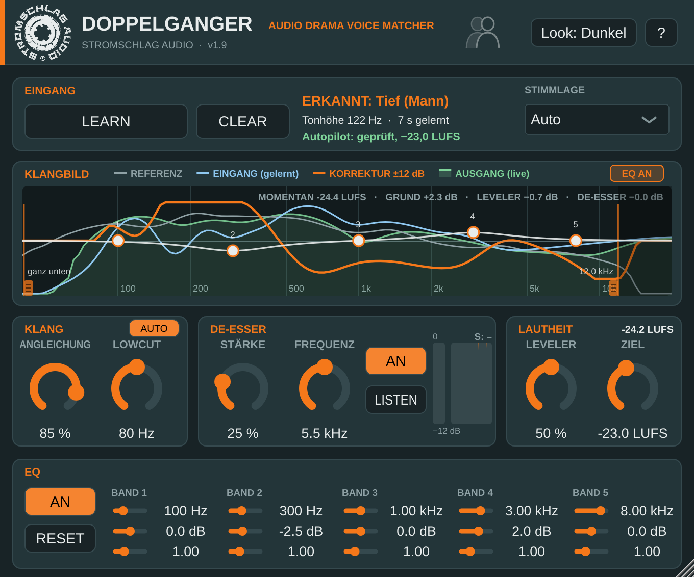

# DOPPELGANGER – Audio Drama Voice Matcher

<picture>
  <source media="(prefers-color-scheme: dark)" srcset="docs/logo-dunkel.png">
  
</picture>

VST3-Insert-Effekt für Hörspiel-Produktion. DOPPELGANGER gleicht Sprecherspuren an **neutrale Sprecherprofile aus
einem Berliner Profi-Studio** an und bringt sie gleich auf die richtige Lautheit. Takes aus unterschiedlichen
Heimstudios, mit unterschiedlichen Mikrofonen und Räumen klingen danach, als wären sie in derselben Kabine
aufgenommen worden, ohne dass man jede Spur mit mehreren Plugins einzeln nachbearbeitet.

**⬇ Download (Windows · VST3 · Mono/Stereo):** https://github.com/StromschlagProductions/Doppelganger-vst/releases/latest

Installation: ZIP entpacken und den Ordner `Doppelganger.vst3` nach `C:\Program Files\Common Files\VST3` kopieren.

**Aktuelle Version: 1.9.** Die eingebaute Hilfe ist auf dem Stand des Autopiloten. **Seit 1.8: Autopilot.** Lernen, bei Bedarf den De-Esser einstellen, fertig: Mit **AUTO** stellt das Plugin Angleichung und Lowcut selbst ein, misst die Lautheit der ganzen Kette nach, schützt die Spitzen bei −1 dBFS und meldet, ob alles passt. Seit 1.7 setzt unter dem EQ-Schalter **RESET** alle fünf Bänder auf 0 dB, Standardfrequenz und Q = 1 zurück. Das Klangbild ist klarer beschriftet: Referenz, gelernter Eingang, Korrektur und Ausgang live haben je ein Farbmuster, der EQ zeigt seinen Zustand. Seit 1.4.1 werden Mono und Stereo kanalrichtig nach BS.1770 gemessen und auf das Lautheitsziel angepasst. Enthalten sind außerdem der Angleich-Bereich, die überarbeitete S-Laut-Erkennung und die integrierte Lautheitsanzeige aus 1.4 sowie der fünfbandige Fein-EQ.

[Was ist neu?](CHANGELOG.md) · [Release-Hinweise und Installation](docs/releases/1.9.md) · [Qualitätsbericht 1.1.1](docs/QUALITY_REPORT_1.1.1.md)

## Warum es dieses Plugin gibt

In einem Hörspiel sprechen oft viele Sprecherinnen und Sprecher, die ihre Rollen zu Hause aufnehmen. Jede Aufnahme
bringt ihr eigenes Mikrofon, ihren eigenen Raum und ihren eigenen Pegel mit: mal dumpf und nah, mal dünn und hallig,
mal zu leise, mal mit scharfen S-Lauten. Stehen die Figuren dann in einer Szene nebeneinander, hört man sofort, dass
sie nicht im selben Raum waren.

Bisher lag deshalb auf jeder Sprecherspur eine Kette aus Match-EQ, Leveler/Kompressor und De-Esser, jede Spur einzeln
an eine männliche oder weibliche Vorlage angeglichen. DOPPELGANGER hat diese Vorlagen fest eingebaut und erledigt
alles in einem Plugin: auf die Spur ziehen, einmal lernen lassen, fertig.

*DOPPELGANGER soll niemandem die Erfahrung abnehmen, eine Stimme selbst anzugleichen. Gerade am Anfang lehrt es viel, wenn man selbst hört, wie Mikrofon, Raum, Zischlaute und Lautheit zusammenspielen. Ich bin dankbar, dass ich diesen Weg selbst gegangen bin, auch wenn er manchmal umständlich und mühselig war. Gerade dadurch weiß ich, was ich mir von einem Werkzeug wünsche, das all das in einem vereint. DOPPELGANGER soll das Arbeiten und Lernen nicht ersetzen, sondern die technische Umsetzung im Alltag einfacher machen. Das Plugin ist auf meinen bevorzugten Klang für Sprecherstimmen bei Hörspielen ausgerichtet, so wie er mir gefällt und wie ich ihn ausgewogen finde. Ich habe ihn als Standard gesetzt.*

– Lars Eickstädt, Stromschlag Audio

## Was das Plugin macht

**Die Vorlagen.** Im Plugin stecken drei neutrale Sprecherprofile, gemessen an Aufnahmen aus einem Berliner
Profi-Studio: eine tiefe Männerstimme, eine mittlere und eine hohe Frauenstimme. Neutral heißt: sauber aufgenommen,
ausgewogen, ohne Färbung durch Raum oder besonderes Mikrofon. So klingt eine Stimme, die man im Hörspiel gern hört.
Gespeichert ist davon nur die Klangkurve, keine Aufnahme.

**Das Lernen.** Beim Lernen hört DOPPELGANGER der Spur zu und misst drei Dinge: das mittlere Klangbild der Stimme
(welche Frequenzen stark oder schwach sind), die Tonhöhe und die Lautheit. Pausen und Atmer zählen nicht mit. Aus der
Tonhöhe wählt es die passende Vorlage.

**Das Angleichen.** Aus dem Unterschied zwischen gelernter Stimme und Vorlage berechnet das Plugin eine
Korrekturkurve und baut daraus einen EQ mit 26 Bändern. Die Kurve ist bewusst geglättet: Angeglichen wird die
Färbung von Mikrofon und Raum, nicht die Stimme selbst. Ein Bass bleibt ein Bass, eine helle Stimme bleibt hell, sie
klingen nur, als stünden sie vor demselben Mikrofon. Wie weit das geht, bestimmt der Regler **Angleichung**. Welcher
Frequenzbereich überhaupt angeglichen wird, legen zwei Begrenzer im Klangbild fest; außerhalb bleibt der Take unverändert.

**Der Autopilot.** Mit **AUTO** (Standard) muss man nach dem Lernen nichts mehr beurteilen. Die Angleichung wird so gewählt, dass im Mittel höchstens 1 dB Färbung von Mikrofon und Raum bleibt (45–85 %). Der Lowcut folgt der Tonhöhe (80–110 Hz). Danach rechnet das Plugin die gelernte Passage im Hintergrund durch die ganze Kette und misst die Lautheit am Ausgang nach. So gleicht es aus, was De-Esser, Leveler und EQ an der Lautheit verschieben. Ein latenzfreier Spitzenschutz hält den Ausgang unter −1 dBFS. In der Karte EINGANG steht dann grün „geprüft“ oder orange ein Hinweis auf das, was kein Regler reparieren kann: Übersteuerung, Rauschen, sehr laute Spitzen.

**Der Weg durchs Plugin.** Lowcut → Angleich-EQ → Feinabstimmung → De-Esser → Grundverstärkung und Leveler → Spitzenschutz (mit AUTO).
Am Ende steht die Spur auf der Ziel-Lautheit (Standard −23 LUFS), sanft geglättet und ohne harte S-Laute. Alles
arbeitet latenzfrei und ab dem ersten Sample, egal wo die Wiedergabe startet.

**Die Feinabstimmung (im Plugin: EQ).** Wer nach dem Angleich noch etwas nachschärfen möchte, schaltet fünf frei einstellbare
Bänder zu, direkt im Klangbild oder über die Regler. Ein zusätzlicher EQ in der Slotkette ist dafür nicht nötig.
Die Feinabstimmung ist auf Sauberkeit geprüft: Ausgeschaltet oder mit allen Bändern auf 0 dB läuft das Signal bitgenau unverändert durch, +6 dB am Regler ergeben auch +6 dB im Klang, und Änderungen werden weich überblendet, damit beim Automatisieren nichts knackt. Kein Band kann über die halbe Abtastrate hinaus (die sogenannte Nyquist-Grenze) gestellt werden: Die Frequenz ist auf 45 % der Abtastrate begrenzt. So bleiben alle Filter auch in Projekten mit niedriger Abtastrate stabil, von 22,05 bis 192 kHz geprüft.

**Wofür es gedacht ist:** Dialogspuren für Hörspiele, Hörbücher und Podcasts, die zusammen klingen sollen.
Nicht gedacht ist es für Gesang, für Effektstimmen (Funk, Telefon, Monster) oder als Rauschunterdrückung: Saubere,
trockene Aufnahmen bleiben die Voraussetzung. Dereverb und Denoise gehören vor das Plugin.

## Oberfläche

<table>
  <tr>
    <td width="50%" align="center"><br>Look dunkel</td>
    <td width="50%" align="center"><br>Look hell</td>
  </tr>
</table>

Beide Bilder zeigen eine gelernte Stimme mit Live-Ausgang und eingeschaltetem EQ.

Oben in der Karte EINGANG wird die Spur gelernt und die erkannte Stimmlage angezeigt. Darunter das Klangbild mit Referenz (grau),
gelerntem Eingang (blau), Korrektur (orange) und dem Ausgang live (grün). Darunter sind Klang, De-Esser und Lautheit, ganz unten der optionale EQ. Die **?**-Taste öffnet die Hilfe.

## Bedienung

1. Plugin auf die Sprecherspur legen (mono oder stereo).
2. **Learn** drücken und die Spur abspielen. Das Plugin prüft selbst, ob sich das Klangbild nicht mehr verändert, und hört dann von allein
   auf (frühestens nach 10, spätestens nach 30 Sekunden Sprache). Man kann auch vorher **Done** drücken (mindestens 4 Sekunden Sprache). Gemessen werden Klangbild, Tonhöhe und Lautheit.
3. Das Plugin zeigt groß an, welche Stimme es erkannt hat (**ERKANNT: Tief (Mann) · 118 Hz**). Bei **Stimmlage: Auto** wählt das Plugin die passende Referenz (unter 160 Hz Mann, bis 225 Hz Frau mittel,
   darüber Frau hoch). Das Gelernte wird mit dem Projekt gespeichert.
4. Mit **AUTO** (Standard) ist damit alles erledigt. Der Autopilot setzt Angleichung und Lowcut, misst die Lautheit nach und zeigt
   **Autopilot: geprüft, −23,0 LUFS**. Erscheint dort stattdessen ein oranger Hinweis (übersteuert, Rauschen, sehr laute Spitzen),
   liegt das Problem in der Aufnahme selbst. Optional den De-Esser nach Gehör nachstellen; danach misst der Autopilot von selbst neu.

## Regler (alle automatisierbar)

| Bereich | Regler | Wirkung |
|---|---|---|
| Klang | **AUTO** | Autopilot an/aus (Standard an). Setzt nach dem Lernen Angleichung und Lowcut, misst die Lautheit der ganzen Kette nach, Spitzenschutz bei −1 dBFS, Prüfbericht in der Karte EINGANG. Aus = Verhalten wie 1.7. |
| Klang | **Angleichung** | Wie stark die Klangfarbe an die Referenz angeglichen wird. Standard 60 %: Mikrofon und Raum werden angeglichen, die eigene Stimmfarbe bleibt. Nur die Klangform, nie der Pegel; höchstens ±9 dB. |
| Klang | **Lowcut** | 24 dB/Oktave, 20–200 Hz (ganz links = aus), Standard 80 Hz. |
| Klang | **Angleich-Bereich** | Zwei Begrenzer im Klangbild (orange Linien mit Griff unten): Angeglichen wird nur dazwischen, außerhalb bleibt der Take unverändert, mit weichem Übergang über eine Drittel-Oktave. Links 20 Hz – 2 kHz (Standard: keine Grenze), rechts 1 – 20 kHz (Standard 12 kHz, weil die Referenzen darüber nicht mehr verlässlich sind). Ziehen, Umschalt = fein, Doppelklick = Standard. Beispiel: rechts auf 8–10 kHz, damit die Luft einer Stimme erhalten bleibt; links auf 100–150 Hz, damit der Nahbesprechungs-Bass unangetastet bleibt. |
| De-Esser | **AN / AUS** | Schaltet den De-Esser gezielt ab, zum Vergleich. |
| De-Esser | **Stärke** | Wie weit Zischlaute abgesenkt werden: 25 % ≈ 3–4 dB, 100 % ≈ 6–10 dB. Erkannt wird ein Zischlaut daran, dass oberhalb der Frequenz mehr Energie liegt als im tiefen Stimmbereich; helle Vokale bleiben deshalb unberührt. |
| De-Esser | **Frequenz** | 3–10 kHz, Standard 5,5 kHz: ab hier sucht und bearbeitet der De-Esser die S-Laute. |
| De-Esser | **Anzeige** | Balken = aktuelle Absenkung (0 bis 12 dB, Strich = letzte Spitze), daneben ein Verlauf der letzten Sekunden: jeder Ausschlag ist ein erkannter und gedämpfter S-Laut. |
| De-Esser | **LISTEN** | Spielt die tatsächlich entfernten Anteile ab (Differenz vor/nach der Absenkung). Ohne Absenkung bleibt es still. Aktiv zeigt der Knopf **DIFF**; für den normalen Klang wieder ausschalten. |
| Lautheit | **Leveler** | Fährt sanft wie ein Fader und gleicht leise und laute Passagen an: 0 % = aus, 100 % = bis ±10 dB. In Pausen und bei Atmern hält er still, die Gesamtlautheit ändert er nicht. |
| Lautheit | **Ziel** | −30 bis −14 LUFS, Standard −23 LUFS. |
| Lautheit | **Messwert** | Oben rechts in der Karte: gemessene Lautheit des Ausgangs, integriert nach EBU R128 (Pausen ausgeblendet), wie ein Loudness-Meter am Ende einer Passage. Beginnt bei jedem Wiedergabestart neu, Klick = zurücksetzen. Orange = innerhalb ±1 LU um das Ziel. |
| EQ | **AN / AUS** | Schaltet die fünf Bänder der Feinabstimmung nach dem Angleich zu. Standard aus; aus oder mit allen Bändern auf 0 dB klingt die Spur unverändert. Oben rechts im Klangbild zeigt **EQ AN** (orange) oder **EQ AUS** (grau) den Zustand. |
| EQ | **Band 1–5** | Frequenz 40 Hz – 20 kHz, Verstärkung ±12 dB, Güte 0,3 – 8 (klein = breit). Standard 100 Hz, 300 Hz, 1 kHz, 3 kHz, 8 kHz, alle 0 dB. Auch direkt im Klangbild: Punkt ziehen (waagerecht Frequenz, senkrecht Verstärkung), Mausrad = Güte, Doppelklick = 0 dB. Umschalt beim Ziehen oder Scrollen = Feinjustierung. Beim Überfahren zeigt ein Tooltip Frequenz, Pegel und Q. |

Die **Grundverstärkung** kommt aus der gelernten Lautheit und bringt die Spur fest auf das Ziel. Sie steht ab dem
ersten Sample, egal an welcher Stelle die Wiedergabe startet. Mit AUTO wird sie nach dem Lernen nachgemessen und korrigiert.
DOPPELGANGER ist **latenzfrei**. Mit AUTO hält ein Spitzenschutz die Sample-Spitzen unter −1 dBFS; ohne AUTO gibt es
keinen, dann fängt der Limiter auf dem Master die Spitzen ab.

Die Grundverstärkung rechnet die Feinabstimmung mit ein: Hebt man Bänder an, bleibt die Spur trotzdem auf dem Ziel, nur die Klangfarbe ändert sich.

**Klangbild:** Die Legende über der Anzeige zeigt zu jedem Namen ein Farbmuster.

- **REFERENZ** (grau): das Ziel, die gewählte neutrale Referenzstimme.
- **EINGANG (gelernt)** (blau): die beim Lernen gemessene Klangform der Spur. Sie steht fest, denn die Korrektur richtet sich nur nach ihr, nicht nach dem Moment.
- **KORREKTUR ±12 dB** (orange): was der Angleich anhebt oder absenkt; die Mittellinie ist 0 dB.
- **AUSGANG (live)** (grün): das Spektrum dessen, was tatsächlich herauskommt, laufend gemessen. Auf gleiche mittlere Höhe wie die Referenz gebracht, es zählt die Klangform: je näher an der grauen Kurve, desto besser passt die Spur.
- **EQ AN / AUS**: ob die Feinabstimmung eingeschaltet ist. Dann zeigt die helle Linie mit den Punkten 1 bis 5 ihren Verlauf.

Abgedunkelt ist der Bereich außerhalb der Angleich-Begrenzer. Oben steht **MOMENTAN** (Lautheit der letzten 0,4 s, springt mit der Sprache), dazu Grundverstärkung, Leveler und De-Esser.

Oberfläche: Look Dunkel/Hell, Fenster frei skalierbar (50–300 %, Start bei 150 %), Hilfe über den **?**-Knopf,
Tooltips an allen Reglern.

## Referenzen

Die drei neutralen Sprecherprofile stammen aus Aufnahmen eines Berliner Profi-Studios (Tief/Mann, Mittel/Frau,
Hoch/Frau). Fest im Plugin hinterlegt sind nur ihre Zielkurven (`Source/ReferenceCurves.h`), die Audiodateien selbst
werden nicht mitgeliefert. Erzeugt werden die Kurven mit:

```
python3 tools/make_reference_curves.py tief=MANN.wav mittel=FRAU1.wav hoch=FRAU2.wav
```

Die Referenzen enden bei ca. 16 kHz (Codec-Grenze). Darüber korrigiert das Plugin nicht, die Höhen der Takes bleiben erhalten.

## Bauen und testen

- Windows-VST3: Der Build mit Regressionstests und pluginval Level 8 läuft nicht bei jedem Commit, sondern von Hand (Actions > „Windows-VST3 bauen“ > Run workflow) und bei Pull Requests. Ein Release entsteht nur, wenn dabei „publish“ angehakt wird. Details: [CI-Konfiguration](docs/CI.md).
- Automatische DSP-/Transporttests ohne JUCE: `cmake -S . -B build/tests -DDOPPELGANGER_TESTS=ON`, danach `cmake --build build/tests` und `ctest --test-dir build/tests --output-on-failure`.
- Prozessor-/State-/Editor-Tests zusammen mit dem VST3: `-DDOPPELGANGER_PLUGIN_TESTS=ON`.
- Die bisherigen Dateitests `test_engine` und `test_learn` werden mitgebaut und mit einem synthetischen Signal automatisch ausgeführt.
- Architektur, Sanitizer-Aufrufe und Benchmark: [technische Prüfung](docs/TECHNICAL_REVIEW.md).

## Qualität und Prüfung

Wenige Regler heißen nicht, dass hier etwas schnell zusammengeschustert wurde. Die Einfachheit liegt in der Bedienung, nicht in der Technik dahinter. Jede Version durchläuft Prüfungen, wie sie auch bei kommerziellen Plugins üblich sind, und alles ist im Quellcode nachvollziehbar:

- **pluginval, Stufe 8:** Vor jeder Veröffentlichung läuft das Prüfprogramm pluginval von Tracktion auf strenger Stufe. Es lädt das Plugin wieder und wieder, wechselt Abtastraten und Puffergrößen, speichert und lädt Einstellungen und fährt alle Regler mit Zufallswerten durch.
- **Automatische Tests der Klangberechnung**, zusätzlich mit Speicher- und Fehlerprüfern (AddressSanitizer, UndefinedBehaviorSanitizer), die auch seltene Programmierfehler aufspüren.
- **Echtzeitsicher:** Während der Wiedergabe wird kein Speicher angefordert und nirgends gewartet. Das verhindert Aussetzer und Knackser, auch bei kleinen Puffern und vielen Instanzen.
- **Saubere Feinabstimmung:** ausgeschaltet bitgenau unverändert, +6 dB am Regler ergeben +6 dB im Klang, kein Filter über der Nyquist-Grenze (siehe oben).
- **Geprüft von 22,05 bis 192 kHz** Abtastrate, mit vielen verschiedenen Puffergrößen.
- **De-Esser an echter Sprache vermessen:** An drei Sprachaufnahmen senkt er Zischlaute bei Standardstärke um 3 bis 4 dB ab, bei Vokalen im Mittel um weniger als 0,1 dB ([Messung](docs/DEESSER_1.4.md)).
- **Lautheit nachgemessen:** Fünf Sprachaufnahmen landeten mit 1.4 nach dem Lernen zwischen −22,1 und −23,4 LUFS (Ziel −23), integriert nach EBU R128. Seit 1.8 rechnet der Autopilot die gelernte Passage durch die ganze Kette nach und gleicht die Abweichung aus: in den automatischen Tests ±0,01 LU bei der Nachmessung und ±0,1 LU bei der Wiedergabe. Die eingebaute Messung ist mit einem 1-kHz-Sinus geeicht.

Ob es gut klingt, entscheidet am Ende das Ohr. Deshalb geht jede Version auch durch den Studioalltag von Markus Hildebrandt (siehe unten).

## Beta-Test und Danke

**SOUNDJOB / Markus Hildebrandt** – Beta-Testing

Ein großes Dankeschön an **Markus Hildebrandt** von SOUNDJOB. Markus betreibt ein eigenes Tonstudio und hat weit mehr Hörspiele produziert als ich. Er hat DOPPELGANGER im Studioalltag getestet und mir ehrliches, fachkundiges Feedback gegeben. Auf seine Anregung hin gibt es seit Version 1.2 die optionale Feinabstimmung mit fünf frei einstellbaren Bändern. Dafür danke ich ihm sehr: Seine Erfahrung hat das Plugin spürbar besser gemacht.

---

## Hinweis / Disclaimer

**Open Source · Work in Progress**

Dieses Plugin wurde in erster Linie für meinen persönlichen Workflow bei der Hörspielproduktion entwickelt. Es ist auf meine eigenen Anforderungen zugeschnitten und muss daher nicht für jeden Anwendungsfall geeignet sein.

Das Projekt wird laufend weiterentwickelt. Trotz sorgfältiger Tests können Fehler oder Kompatibilitätsprobleme auftreten. Die Software wird ohne Gewährleistung bereitgestellt; die Nutzung erfolgt auf eigene Verantwortung. Eine Haftung für mögliche Schäden oder Datenverluste wird, soweit gesetzlich zulässig, ausgeschlossen. Es gelten die jeweiligen Lizenzbedingungen.

**Feedback, Fehlermeldungen und Verbesserungsvorschläge sind herzlich willkommen!**

Wenn dieses kleine Werkzeug auch anderen die Hörspielarbeit erleichtert und mehr Raum für Geschichten und menschliche Kreativität schafft, freut mich das ganz besonders.

Öffentliches Versionsschema und Release-Ablauf: [Versionsnummern](docs/VERSIONING.md).
