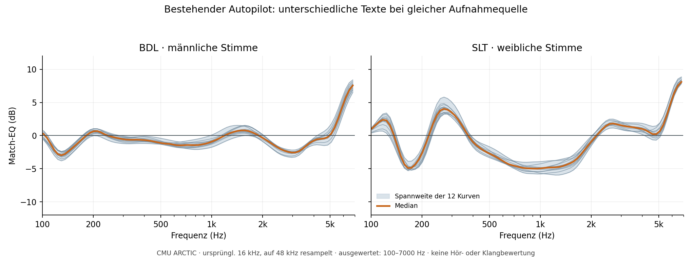

# Prüfung der Lernstabilität

Stand: 27. November 2026. Geprüfter DSP-/Processor-Stand: `a130fd4e803fa097d7a72b34d4a25737f5e798ac` (Reliability-Fixes aus PR #16, noch nicht `main`). Diese Prüfung verändert keine Plugin-Funktion und keine Klangparameter.

## Ergebnis

Die vorhandene Abstimmung erzielt in diesem begrenzten Praxistest bereits recht ähnliche Match-EQ-Kurven aus unterschiedlichen Texten derselben Aufnahmequelle. Ein grundlegender Umbau ist durch diese Ergebnisse nicht begründet. Sehr kurze Lernphasen streuen stärker; mehr repräsentative Sprache verbessert die Wiederholbarkeit weiter.

Eine bekannte, breite zusätzliche EQ-Färbung wurde in allen 24 Vergleichsfällen teilweise ausgeglichen. Das belegt eine sinnvolle technische Wirkung des Matchings unter diesen Bedingungen. Es beweist weder einen universellen „Hörspielklang“ noch die klangliche Eignung der drei eingebauten Referenzen für jede Stimme.

Für den hier beschriebenen CMU-ARCTIC-Test lagen die ursprünglichen Studio-Referenzen und die eigenen Sprecheraufnahmen noch nicht vor. Die später nachgereichten drei Referenzen sind inzwischen [separat geprüft](REFERENCE_RECORDINGS_AUDIT_2.3.md): Die eingebauten Kurven stimmen exakt mit ihnen überein; bei einem kurzen manuell beendeten Ausschnitt ist ein Registerwechsel reproduziert. Die eigenen Sprecher-Takes fehlen weiterhin. Der folgende Test verwendet zwei echte Stimmen aus CMU ARCTIC.

## Material und Verfahren

- CMU ARCTIC: BDL (männlich) und SLT (weiblich), je 240 Sätze, aufgeteilt in zwölf getrennte Gruppen mit je 20 Sätzen. Die Gruppen sind pro Stimme disjunkt; beide Stimmen lesen dieselbe deterministisch ausgewählte Satzliste. Seed, Dateinamen, Dataset-Revision und SHA-256 stehen in [provenance.json](learning-stability/provenance.json) und [source.json](learning-stability/source.json).
- Englische, einzeln gelesene Studiosätze aus derselben Aufnahmequelle je Stimme; keine wechselnden Mikrofone, Rollen oder emotionalen Szenen. Die Zahl der unabhängigen Stimmen beträgt zwei, nicht 480.
- Originalformat: **16 kHz mono**. Für den vorhandenen Plugin-Code auf 44,1 und 48 kHz resampelt. Das erzeugt keine zusätzlichen Höheninformationen. Alle hier genannten Kurvenmetriken beziehen sich ausschließlich auf **100–7000 Hz**.
- 48 AUTO-Läufe: zwölf Textgruppen × zwei Stimmen × zwei Sampleraten. Zusätzlich bei 48 kHz je Gruppe eine kurze Lernphase (acht Sekunden Eingangsdatei) und die vollständige Gruppe (ungefähr eine Minute), sowie Wiederholungs-, Pegel- und Blockgrößenkontrollen.
- AUTO verwendet die bestehenden Konvergenzkriterien und die bestehende Höchstdauer. Die vollständige Gruppe ist eine diagnostische Lernmessung ohne AUTO-Abbruch, keine bereits vorhandene Offline-Bedienfunktion.
- Der Kernprüfer verwendet unverändert `DoppelgangerDSP.h`: Lernprofil, Register, Autopilot-Parameter und tatsächlich gefittete Bell-EQ-Antwort. Für zwölf ausgewählte AUTO-Fälle wurde dies gegen den echten JUCE-Processor mit `processBlock`, Lern-Timer und Autopilot abgeglichen. Timer-Aufrufe erfolgen deterministisch etwa alle 33 ms Audiozeit; DAW-Scheduling und Benutzeroberfläche werden damit nicht bewertet.

## Wie stark unterscheiden sich die Kurven?

Pro Stimme werden alle 66 Paare ihrer zwölf Kurven verglichen. Je Paar wird der Betrag ihrer dB-Differenz über das logarithmische Referenzraster von 100 bis 7000 Hz gemittelt. Die Tabelle zeigt den Median dieser 66 Mittelwerte bei 48 kHz. Sie misst die Streuung des **Match-EQ-Frequenzgangs**, keine LUFS-Differenz und keine Klangqualität.

| Lernverfahren | BDL | SLT |
| --- | ---: | ---: |
| Kurzer Ausschnitt: 8 Sekunden Eingang | 0,62 dB | 0,79 dB |
| Bestehendes AUTO: etwa 20–30 Sekunden erkannte Sprache | **0,46 dB** | **0,58 dB** |
| Ganze Gruppe: ungefähr eine Minute Eingang, diagnostisch | 0,27 dB | 0,37 dB |

AUTO ist damit stabiler als die kurzen Ausschnitte, aber nicht völlig unabhängig vom Text. Das Paar mit dem größten mittleren Abstand liegt bei 0,83 dB (BDL) bzw. 1,14 dB (SLT). Die größte **einzelne Frequenzabweichung über alle AUTO-Paare** beträgt 2,88 dB bei etwa 5,60 kHz (BDL, Gruppen 04/09) und 3,09 dB bei etwa 129 Hz (SLT, Gruppen 03/07). Der kleine Median darf also nicht als Obergrenze für jedes Frequenzband gelesen werden.

Bei 44,1 kHz liegen die AUTO-Mediane bei 0,45/0,57 dB. Im Vergleich derselben Textgruppe zwischen den Sampleraten beträgt der Median des mittleren Kurvenabstands 0,009/0,039 dB; der größte mittlere Abstand beträgt 0,010/0,307 dB. Beide Sampleraten liefern hier ähnliche, nicht bitidentische Ergebnisse.

Die absoluten Höhenanhebungen im Bild sind **keine Empfehlung für eine Hörspielstimme**. Die auf 8 kHz begrenzte Quellbandbreite beeinflusst den Vergleich mit den breitbandigen eingebauten Referenzen. Dieser Test bewertet vor allem die Streuung bei gleichbleibender Quelle; er validiert weder den absoluten Klang dieser Kurven noch die Bearbeitung oberhalb von 7 kHz.

## Funktioniert der Ausgleich einer Aufnahmefärbung?

Zur selben 48-kHz-Sprachdatei wurde eine bekannte stationäre Färbung hinzugefügt: +4 dB Bell bei 350 Hz (Q 0,7) und −6 dB High-Shelf bei 3 kHz. Anschließend wurden die unveränderten AUTO-Ergebnisse der gefärbten und ursprünglichen Datei verglichen.

Gemessen wird die Restfärbung aus `bekanntem Filter + EQ(gefärbt) − EQ(ursprünglich)`, jeweils um den mittleren Pegel bereinigt. Ihr RMS-Abstand über 100–7000 Hz sinkt von 2,95 dB auf median 1,05 dB bei BDL und 1,00 dB bei SLT. **Alle 24 Paare verbessern sich**, ohne Registerwechsel; die Restwerte liegen zwischen 0,90 und 1,30 dB.

Das ist eine lineare Frequenzgangrechnung des Match-EQ. Adaptive Lowcut-Unterschiede und dynamische Bearbeitung sind darin nicht enthalten. Ein echter Mikrofonwechsel kann zusätzlich Nahbesprechung, Raum, Richtwirkung, Rauschen und Verzerrungen verändern. Der Versuch ist ein kontrollierter Wirksamkeitsnachweis für diese breite EQ-Färbung, kein Hörtest und keine allgemeine Mikrofon-Garantie.

## Wiederholbarkeit und vorhandene Schutzmaßnahmen

- Derselbe Eingang liefert bei erneuter Auswertung identische Profile und EQ-Designs.
- Bei fester vollständiger Lernstrecke liefern 137 und 512 Samples Blockgröße identische Profile und Designs. Daraus folgt keine identische AUTO-Abbruchzeit bei beliebigem Host-Timing.
- 24 dB geringerer Eingangspegel ändert die Kurven im Kontrollfall praktisch nicht: mittlere Abstände unter 0,000001 dB (BDL) bzw. 0,0042 dB (SLT). Das gilt für diese ausreichend lauten, sauberen Beispiele; kein Nachweis für beliebig leise oder verrauschte Sprache.
- Alle 48 AUTO-Läufe beenden das Lernen. Die erkannte Sprache liegt bei ungefähr 20–30 Sekunden; das Maximum kann um einen Analyse-/Timer-Schritt überschritten werden. Ein Erreichen des Zeitlimits ist keine zusätzliche Konvergenzgarantie.
- BDL bleibt in allen echten Sprachfällen im Register Tief, SLT im Register Mittel. Eine weibliche Stimme muss nicht automatisch im Register Hoch liegen; die Auswahl folgt hier der Grundfrequenz.
- In zwölf echten Processor-Kontrollen sind Profil, Grundfrequenz, Register und Abbruchzeit mit dem Kernprüfer identisch. Die Korrekturkurven unterscheiden sich höchstens um 0,0000053 dB durch den normalisierten JUCE-Parameterpfad.

## Offener Randfall: Registergrenzen

Die Registerauswahl hat harte Grenzen bei 160 und 225 Hz. Zusätzliche synthetische Tests prüfen die Umgebung dieser Grenzen mit unterschiedlicher Häufigkeit von Zischlauten. Ein isolierter Vergleich desselben Profils mit zwei benachbarten Referenzen zeigt: Tief/Mittel kann im Beispiel im Mittel 0,26 dB, Mittel/Hoch 1,13 dB Unterschied erzeugen; der größte lokale Unterschied liegt bei 1,44 bzw. 3,57 dB.

Das ist eine mögliche Ursache stärkerer Änderungen bei Stimmen nahe einer Registergrenze. **In den beiden echten Teststimmen wurde ein solcher Wechsel nicht beobachtet.** Der isolierte Vergleich ist kein nachgewiesener Fehler eines realen Takes. Bevor hier Hysterese, feste Sprecherzuordnung oder Referenzmischung eingebaut wird, sollte der Fall mit echten Grenzstimmen reproduziert werden.

Nachtrag: Mit der später nachgereichten Mittel-Referenz wurde ein solcher Wechsel für eine fünf Sekunden lange, manuell beendete Lernphase [inzwischen bestätigt](REFERENCE_RECORDINGS_AUDIT_2.3.md). Ein regulärer AUTO-Abschluss mit längerem Material derselben Stimme bleibt zu prüfen.

## Konsequenz für die Nutzung

Das bestehende AUTO-Lernen zunächst vollständig durchlaufen lassen und repräsentative, normal gesprochene Passagen verwenden. Sehr frühes manuelles Beenden erhöht hier die Streuung. Innerhalb einer gleichbleibenden Sprecher-/Aufnahmesituation ist ein einmal vollständig gelerntes und gespeichertes Profil eine sinnvolle Grundlage für weitere Takes; nach Mikrofon-, Raum- oder wesentlichen Aufnahmeänderungen muss seine Eignung erneut geprüft werden.

Die bisherige Feinabstimmung hat einen messbaren Nutzen. Längeres gemeinsames Lernen mehrerer Takes könnte die Streuung weiter reduzieren, ist aber anhand dieser Daten keine zwingende Voraussetzung für ein funktionierendes Plugin. Ein zusätzlicher Kompressor würde die untersuchte spektrale Textabhängigkeit nicht beheben.

Die nächste aussagekräftige Prüfung der eigenen Aufnahmen benötigt mehrere eigene Takes je Aufnahmequelle. Die ursprünglichen drei Referenzaufnahmen sind inzwischen separat geprüft (siehe Nachtrag). Kurvenstreuung, Registergrenzen und der Frequenzbereich oberhalb 7 kHz sind mit dem tatsächlichen Material zu bewerten. Ein „grünes“ AUTO-/Lautheitsergebnis allein bescheinigt keinen universell richtigen Stimmklang.

## Nachweise und Reproduktion

Die [Werkzeuganleitung](../tools/learning-stability/README.md) beschreibt Aufbau und Wiederholung. Rohmesswerte, Zusammenfassungen und Provenienz liegen unter [learning-stability](learning-stability/). Es werden keine Sprachaufnahmen oder Transkripte im Repository abgelegt.

Quelle: John Kominek und Alan W. Black, [CMU ARCTIC Databases for Speech Synthesis](https://www.cs.cmu.edu/~awb/papers/ssw5/arctic.pdf); [Originalprojekt](https://festvox.org/cmu_arctic/). Download über den öffentlichen [Dataset-Mirror](https://huggingface.co/datasets/MikhailT/cmu-arctic), auf die aufgezeichnete Revision und Parquet-Prüfsummen festgelegt. Die ursprünglichen Festvox-Downloads waren beim Test nicht erreichbar.
